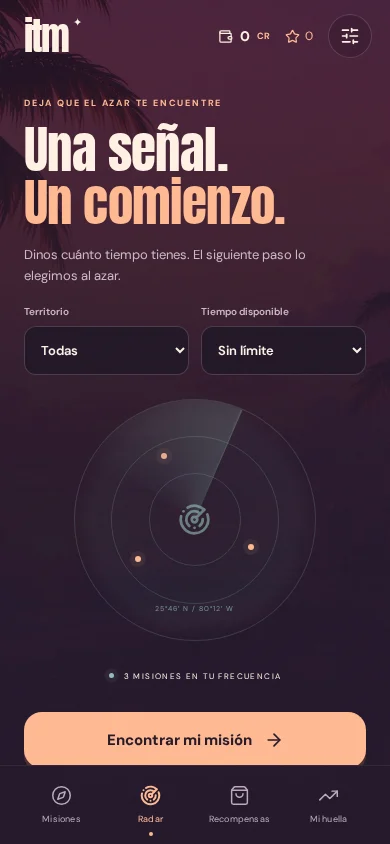

# Verificación

## Comprobaciones automáticas

`npm test`: 18 casos sobre temporizadores tras suspensión/recarga, pausas, recompensas idempotentes, rachas por fechas locales, recurrencia, tareas de penalización por múltiplos, reglas desactivadas, confiscación configurable, migración de partidas y CSV.

`npm run lint`: comprobación de tipos con TypeScript.

`npm run build`: build de producción y creación de la caché offline a partir de los archivos producidos.

## Revisión de navegador

La interfaz se revisa en Chromium con emulación táctil de móvil. Los tamaños cubiertos son 320 × 568, 390 × 700, 390 × 844 y 430 × 932; también se comprueba que la aplicación siga contenida y sin desbordamiento en 768 y 1440 px.

Flujos revisados: selección de misión, deslizamiento, iniciar/pausar/continuar, recarga con temporizador vencido, completar y celebrar, creación de una regla y activación/cumplimiento de una consecuencia, bonus y recompensas, archivo, CSV, copia JSON, rechazo de copia inválida, reducción de movimiento y recarga offline.

No sustituye una prueba física de Safari/iOS o Android. No se incluyen notificaciones push, alarmas con la aplicación cerrada ni sincronización entre dispositivos.

## Capturas

| Inicio                              | Concentración                               | Radar                               |
| ----------------------------------- | ------------------------------------------- | ----------------------------------- |
|  |  |  |

Resultado local: 18 pruebas de lógica, comprobación de tipos y build correctos; 18 comprobaciones de interacción en Chromium correctas, sin errores de ejecución del navegador.
